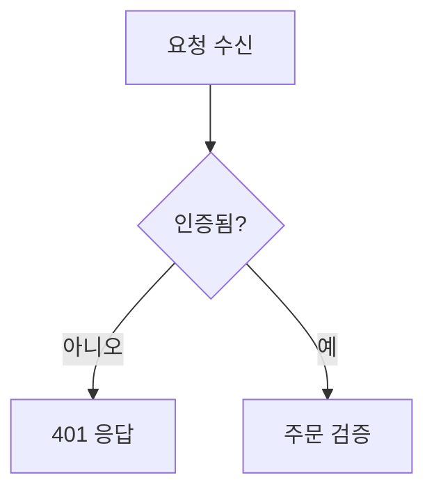

# <흐름 이름>

<이 흐름이 하는 일을 한 줄로 적는다.>

## 단계와 코드 위치

| 단계 | 위치 |
|---|---|
| 요청 수신 | `src/api/orders.ts:createOrder` |

## 특이사항

- 코드에서 확인한 예외 경로, 순서 의존, 숨은 규칙 등을 위치와 함께 적는다.

<!-- 아래 줄에는 확인한 코드의 기준을 기록한다. 해당 흐름에 커밋하지 않은 변경이 있으면
     SHA 옆에 '작업 트리 변경 포함'을, git 저장소가 아니면 날짜와 'git 아님'을 적는다. -->

맞춰 본 커밋: <짧은 SHA>
